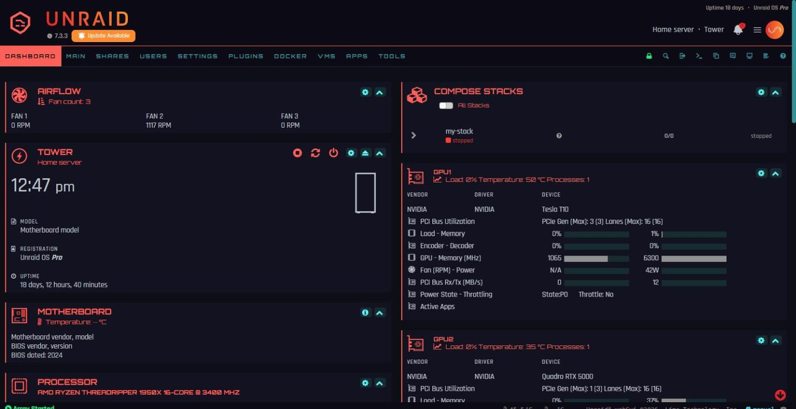
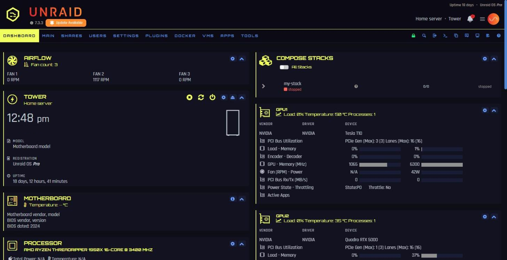
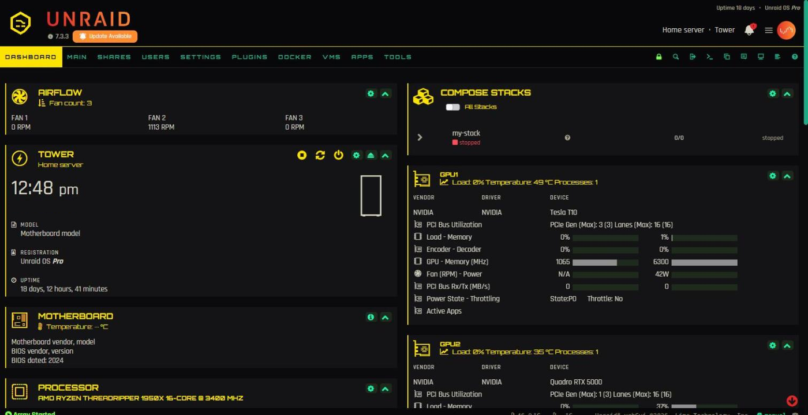
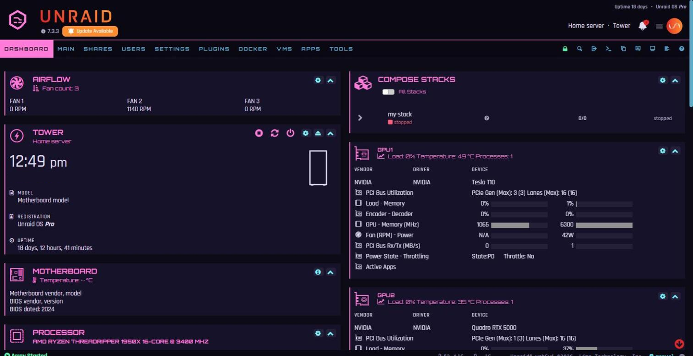
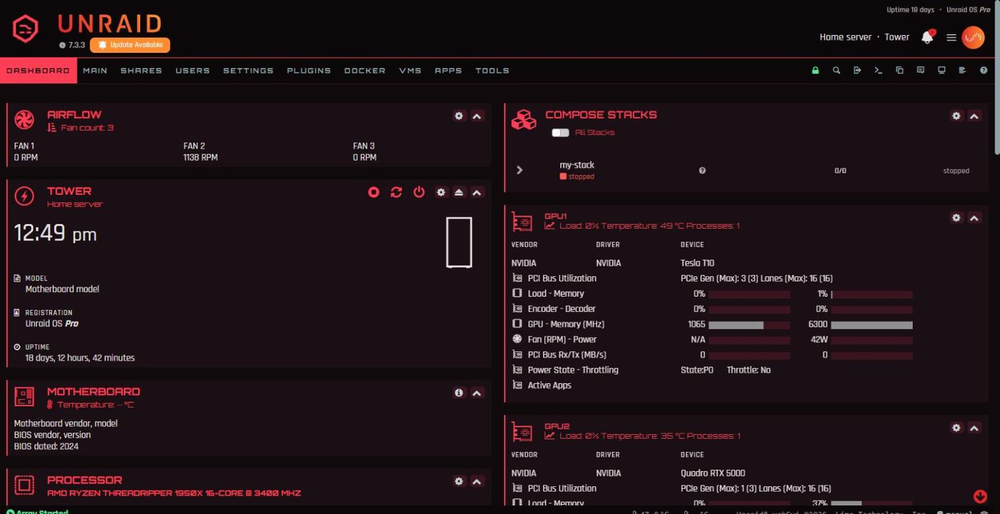
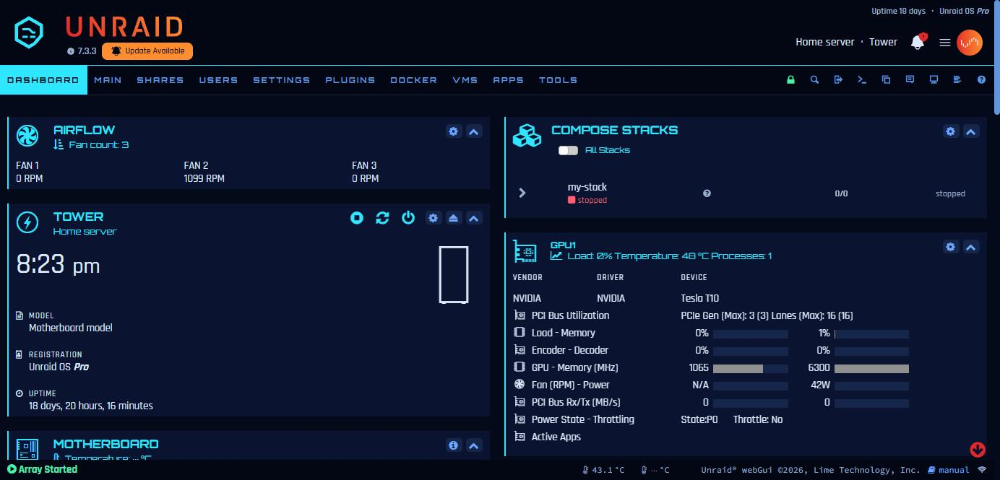
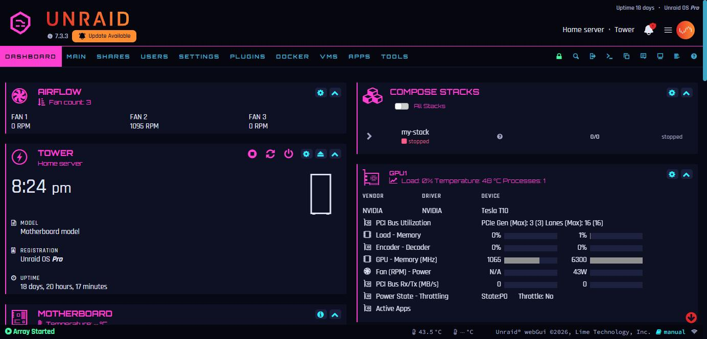
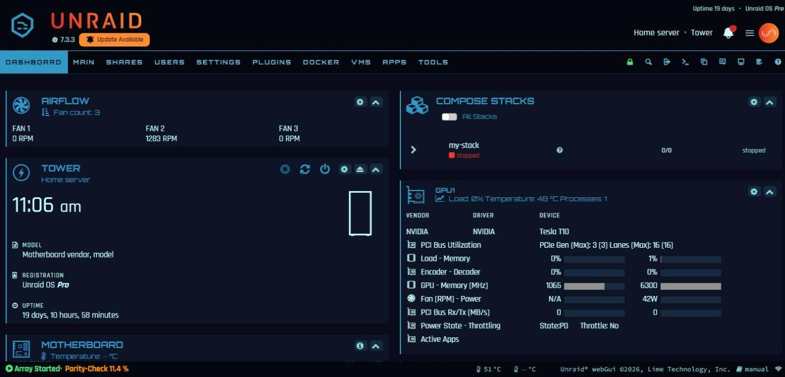
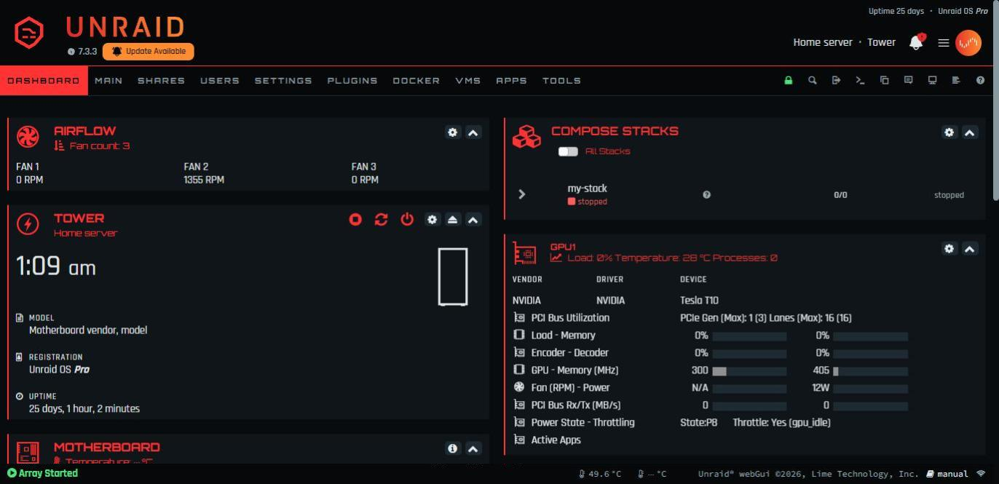
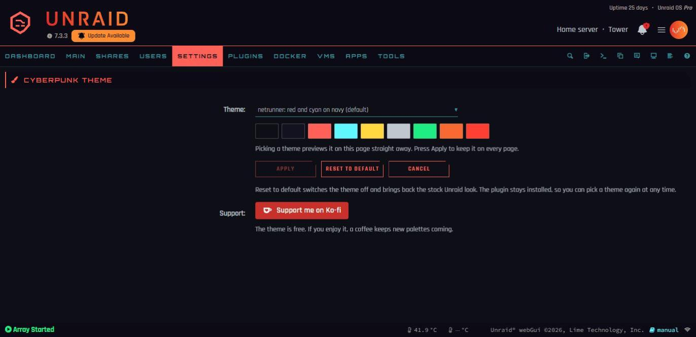

# Unraid cyberpunk theme

[](https://ko-fi.com/liekos47)

A dark, neon webGUI theme for Unraid 7.x, installed as a plugin: near-black panels, angular cut corners, Rajdhani and Orbitron type, and nine palettes you switch between from a settings page.

| Palette | Headings and accents | Values and links |
|---|---|---|
| `netrunner` (default) | red `#FF6159` | cyan `#5EF6FF` |
| `relic` | acid yellow `#F1FF5E` | electric blue `#6DA1FF` |
| `edgerunner` | jacket yellow `#FCE300` on black | speed-trail green `#22F5B0` |
| `lunar` | hot pink `#FF7AD9` on deep violet | cyan `#7CF6FF`, pastel violet highlights |
| `phantom-liberty` | crimson `#FF3D55` on red-black | silver `#C8D8D8`, orange-red highlights |
| `midnight` | cyan `#2FE6FF` on midnight blue | electric blue `#6FA8FF`, ice-white highlights |
| `neon-night` | neon pink `#FF3FD2` on blue-black | neon cyan `#2EF2FF`, electric violet highlights |
| `normandy` (*Mass Effect*) | title blue `#3199C6` on deep indigo | HUD teal `#8CDBDC`, renegade orange highlights |
| `n7` (*Mass Effect*) | N7 red `#FF3333` on gunmetal | armour white `#E6ECEF`, medal silver highlights |

Run one palette per server and you can tell your boxes apart at a glance. `edgerunner` and `lunar` are inspired by David and Lucy from *Cyberpunk: Edgerunners* (colours picked by eye); `phantom-liberty` takes its hues from the *Phantom Liberty* expansion's key art. `midnight` is an all-blue cyber look, `neon-night` a pink and cyan dual-neon one, and `normandy` is inspired by *Mass Effect*, named after Shepard's ship: its colours are sampled from the original game's menus and HUD. `n7` is mainly red with white and steel accents, after the N7 armour: its reds are the game's own and its white and steels come from the N7 Elite medal. Only hex values are used, no official asset.

## Previews

Unraid 7.3.3 dashboard, black base theme, placeholder logo. Server details in the screenshots are replaced with stand-ins.

**netrunner**



**relic**



**edgerunner**



**lunar**



**phantom-liberty**



**midnight**



**neon-night**



**normandy** (inspired by *Mass Effect*)



**n7** (inspired by *Mass Effect*)



## How it works

Unraid evaluates every plugin page marked `Menu="Buttons"` in the `<head>` of every webGUI page, right after its own theme stylesheet. This theme is one such page (`plugin/CyberpunkTheme.page`) that adds three stylesheets for the palette you picked. **No Unraid file is modified.** The stock themes are built on CSS variables, so the theme mostly remaps those variables, plus a few rules for shapes and for colours that Unraid or its plugins set directly.

- Works on any base theme. `black` is recommended (Settings > Display Settings).
- Text contrast was checked at 4.5:1 or better on Dashboard, Main, Shares, Users, Settings, Plugins, Docker, VMs, Tools and Syslog, on the black and white bases. Exceptions left stock: Unraid's orange "Update Available" badge and the brief "checking..." text on the Plugins page.
- Tested on Unraid 7.3.3. A later Unraid release can change the page markup; the fallback is always the stock theme, never a broken page.

## Install

In the webGUI, open **Plugins > Install Plugin**, paste this URL and press **Install**:

```
https://raw.githubusercontent.com/liekos47/unraid-cyberpunk-theme/main/cyberpunk-theme.plg
```

Then open **Settings > User Utilities > Cyberpunk Theme**:



- **Theme**: palettes grouped by where they come from (Cyberpunk 2077, Cyberpunk: Edgerunners, Neon, Mass Effect). Picking one previews it on that page straight away, with its colour swatches.
- **Apply** keeps it on every page. No reboot, no script.
- **Reset to default** switches the theme off and brings back the stock Unraid look. The plugin stays installed, so you can pick a theme again at any time.

Unraid reinstalls the plugin at every boot and keeps your choice on the flash drive (`/boot/config/plugins/cyberpunk-theme/cyberpunk-theme.cfg`). Updates show on the Plugins page like any other plugin.

Questions and support: the [Unraid forum thread](https://forums.unraid.net/topic/201118-plugin-cyberpunk-theme-for-unraid-7x-nine-neon-palettes-picked-from-a-settings-page-no-unraid-files-modified/). Bug reports and new palettes: [GitHub issues](https://github.com/liekos47/unraid-cyberpunk-theme/issues).

## Turn off, uninstall

- **Back to the stock look, plugin kept:** Reset to default on the settings page.
- **Uninstall:** Plugins > Installed Plugins, remove Cyberpunk Theme. Nothing is left on the server or the flash drive. If you switched the base theme to black for this, set it back in Settings > Display Settings (Unraid's default is white).
- **Emergency switch**, if a future Unraid release ever makes a page unreadable: from a shell, `touch /boot/config/plugins/cyberpunk-theme/DISABLED` and reload. Delete the file to turn the theme back on.

## Your own logo

The header shows `icons/logo.svg`, an original placeholder mark tinted with the palette. To use your own:

```bash
python tools/make_icons.py my-logo.png     # on any PC with Pillow
```

That writes `icons/logo.png` (header mark) and `icons/fav-{green,red,yellow}-on.png` (array-state favicons, which keep their meaning: green started, red stopped, yellow in transition). Copy them to `/boot/config/plugins/cyberpunk-theme/icons/` on the server; the plugin picks them up at the next boot, or straight away with `cp /boot/config/plugins/cyberpunk-theme/icons/*.png /usr/local/emhttp/plugins/cyberpunk-theme/icons/`. Any PNG whose shape is in its alpha channel works. Uninstalling the plugin deletes that folder too, so keep a copy.

Only use artwork you have the right to use.

## Manual install (without the plugin)

The theme also runs without the plugin system, configured by a text file instead of the settings page. Do not use both on one server: the manual install steps aside when it finds the plugin.

```bash
# 1. Put the files on the flash drive
mkdir -p /boot/config/cyberpunk-theme
cd /tmp && curl -fsSL https://github.com/liekos47/unraid-cyberpunk-theme/archive/refs/tags/v2.0.0.tar.gz | tar xz
cp -r /tmp/unraid-cyberpunk-theme-2.0.0/* /boot/config/cyberpunk-theme/

# 2. Optional: pick the palette (default netrunner, or off for the stock look)
echo 'PALETTE=relic' > /boot/config/cyberpunk-theme/theme.cfg

# 3. Install now (downloads the two OFL fonts once from github.com/google/fonts)
bash /boot/config/cyberpunk-theme/install.sh

# 4. Reinstall at every boot (the webGUI lives in RAM)
grep -q cyberpunk-theme /boot/config/go || cat /boot/config/cyberpunk-theme/go-snippet.sh >> /boot/config/go
```

Reload the webGUI (Ctrl+F5). Change `theme.cfg` at any time; the next page load uses it. Turn off with `touch /boot/config/cyberpunk-theme/DISABLED`; uninstall with `bash /boot/config/cyberpunk-theme/uninstall.sh` (removes the live theme and its lines in `/boot/config/go`), then `rm -rf /boot/config/cyberpunk-theme`. A custom logo goes in `/boot/config/cyberpunk-theme/icons/`, followed by `install.sh`.

## Add a palette

Copy `palettes/netrunner.css` to `palettes/<name>.css`, change the `--cp-*` colours and the `@group` / `@desc` line at the top (the group and description shown in the settings list). Then check it:

```bash
python tools/check_contrast.py palettes/<name>.css   # offline, every text colour on every surface
```

and paste `tools/contrast-scan.js` into the browser console on the Dashboard, Main and Plugins pages.

The full steps, from what each colour does to testing on a server without losing your setup, scrubbed screenshots and building and releasing the plugin, are in [docs/DEVELOPING.md](docs/DEVELOPING.md).

## Credits and licences

- Code: MIT, see `LICENSE`.
- Fonts: [Rajdhani](https://github.com/google/fonts/tree/main/ofl/rajdhani) (Indian Type Foundry) and [Orbitron](https://github.com/google/fonts/tree/main/ofl/orbitron) (Matt McInerney), SIL Open Font License 1.1. They are not in this repository: the plugin package bundles them with their licences, and `install.sh` downloads them for a manual install.
- A fan-made theme inspired by the look of cyberpunk games. Not affiliated with or endorsed by CD PROJEKT RED, BioWare, Electronic Arts or Lime Technology. No game assets are included.
